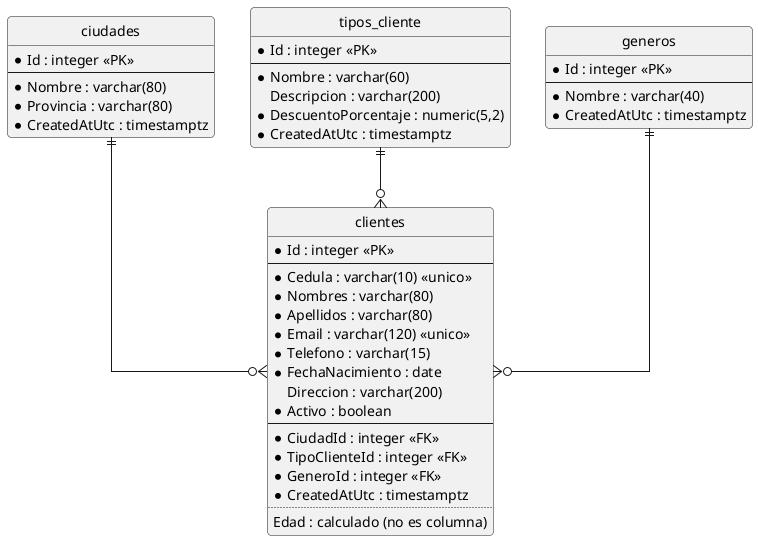

# ClientesApp

Sistema web de gestión de **Clientes** (CRUD) en C# con ASP.NET Core MVC, Entity Framework Core y PostgreSQL.

## Enunciado

> Usted debe crear todos los procedimientos necesarios para crear mediante C# el CRUD de la tabla clientes en un entorno web, mínimo 10 campos.

## Qué incluye

### Modelo de datos

<summary>Código PlantUML del diagrama</summary>



Para verlo en Visual Studio Code, instala la extensión **PlantUML** y usa `Alt+D`. También se puede pegar en <https://www.plantuml.com/plantuml>.
</details>

**Operaciones:** listar, crear, editar y eliminar clientes.

## Requisitos

- Visual Studio con la carga de trabajo **ASP.NET y desarrollo web**, en una versión compatible con **.NET 10** (Visual Studio 2026).
- **.NET 10 SDK** (se instala junto con Visual Studio).
- **PostgreSQL** instalado y corriendo en tu equipo (puerto 5432 por defecto).

## Cómo levantarlo en Visual Studio

### 1. Configurar la conexión a la base de datos

En la raíz del proyecto (junto a `ClientesApp.sln`) copia `sample.env` y llama a la copia `.env`:

```
copy sample.env .env
```

Abre `.env` y pon los datos de tu PostgreSQL local:

```
DB_HOST=localhost
DB_PORT=5432
DB_NAME=clientesapp
DB_USER=postgres
DB_PASSWORD=la_clave_de_tu_postgres
AUTO_MIGRATE=true
```

> `DB_PORT` debe ser el puerto de tu PostgreSQL (normalmente 5432).
> `.env` contiene credenciales: no se sube a git.

### 2. Base de datos

No hace falta crear tablas a mano. Al arrancar, la aplicación aplica las migraciones y crea las tablas y los datos iniciales.

Si la base `clientesapp` no existe, EF intenta crearla (el usuario necesita permiso para crear bases de datos). Si prefieres crearla tú, en pgAdmin o `psql` ejecuta:

```sql
CREATE DATABASE clientesapp;
```

### 3. Ejecutar

1. Abre `ClientesApp.sln` en Visual Studio.
2. Presiona **F5** (o el botón de ejecutar con el perfil `http`).
3. Se abre el navegador con la portada. Entra a **Clientes** para ver el listado.

Al primer arranque se crean las tablas `clientes`, `ciudades`, `tipos_cliente`, `generos` y `__EFMigrationsHistory`.

## Estructura del proyecto

Monolito MVC con las capas separadas en carpetas y principios SOLID:

```
src/ClientesApp
├── Domain            Entidades (Cliente, Ciudad, TipoCliente, Genero)
├── Application
│   ├── Abstractions  Interfaces (IRepository, IClienteService, ...)
│   ├── Services      Casos de uso (ClienteService, LookupService)
│   ├── Validators    Reglas de validación con FluentValidation
│   └── Dtos          Objetos de transferencia de datos
├── Infrastructure
│   └── Persistence   DbContext, repositorios, configuración EF y migraciones
├── Controllers       ClientesController, HomeController
└── Views             Vistas Razor (Home, Clientes, Shared)
```

## Migraciones nuevas

Si cambias una entidad, crea una migración desde Visual Studio:

**Herramientas → Administrador de paquetes NuGet → Consola del Administrador de paquetes**, con el proyecto predeterminado `ClientesApp`:

```
Add-Migration NombreDeLaMigracion -OutputDir Infrastructure/Persistence/Migrations
```

Se aplica sola la próxima vez que ejecutes la aplicación.

(Alternativa por terminal, requiere la herramienta `dotnet-ef` versión 10: `.\scripts\migrations.ps1 -Name NombreDeLaMigracion`)

